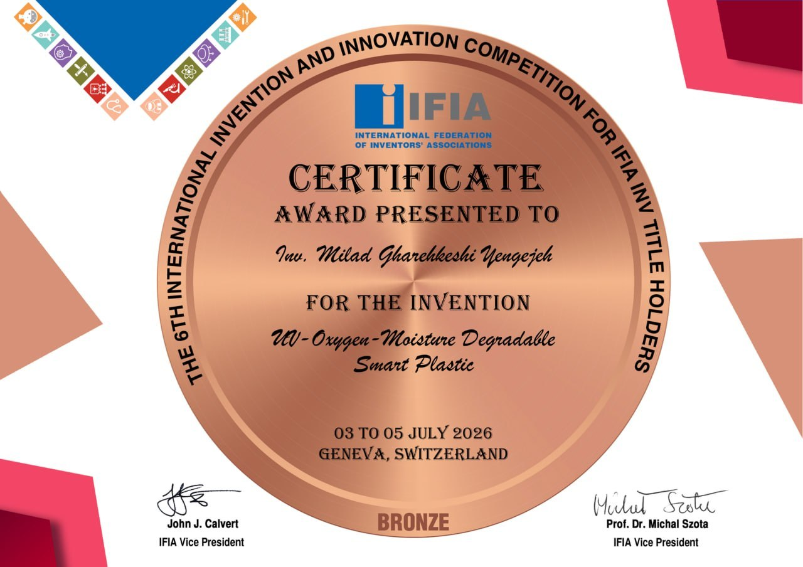
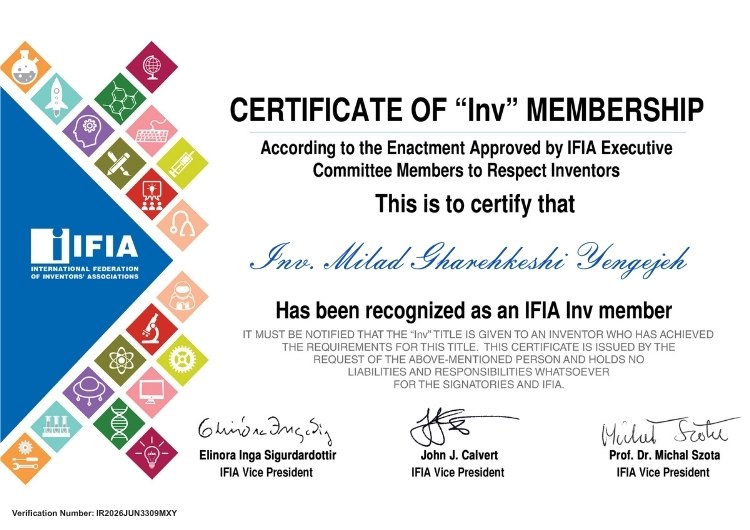

# 🏆 International Achievements & Recognition

### 🌍 About IFIA
The International Federation of Inventors' Associations (IFIA) is an international non-profit organization established in 1968, dedicated to promoting invention, innovation, and cooperation among inventors worldwide.

🔗 [Official Website](https://ifia.com/)

### 🥉 Bronze Award | 2026
Achievement: Bronze Award at the 6th International Invention and Innovation Competition for IFIA INV Title Holders, held in Geneva, Switzerland.

Award Recipient: Milad Gharehkeshki

Recognized Invention: *UV–Oxygen–Moisture Degradable Smart Plastic* — a concept focused on plastic degradation and environmental sustainability.

### 🎖️ IFIA INV Title Holder
Received an official certificate recognizing me as an IFIA INV title holder, acknowledging my involvement in the international invention and innovation community.

---

🌱 Interests: Invention, Innovation, Technology, Engineering, and Sustainable Development.
